# Esquema de la base de datos

Base de datos **SQLite** en `app/data/users.db` (volumen Docker `flask_data`).
Las tablas se crean al arrancar (`app/main.py`) con Flask-SQLAlchemy; los
modelos están en `app/models/db/`.

> Los archivos **no** se guardan en la base de datos: la nube personal está en
> `app/cloud/<usuario>/` (volumen `flask_cloud`) y la de cada grupo en
> `app/cloud_groups/<id>/` (volumen `flask_groups`). En la base de datos solo
> se guardan rutas relativas a esas carpetas (`folder_shares.path`,
> `public_folders.path`).

## Diagrama entidad-relación

Imagen: [esquema_bd.png](esquema_bd.png). GitHub dibuja también el diagrama de abajo (Mermaid).

```mermaid
erDiagram
    users {
        INTEGER id PK
        VARCHAR50 username UK "único"
        VARCHAR120 email UK "opcional"
        VARCHAR20 phone UK "opcional"
        VARCHAR255 password_hash
        DATETIME last_login
        INTEGER storage_gb "espacio total"
        BOOLEAN is_admin
        VARCHAR20 status "pending, active, suspended"
        TEXT notes
        DATETIME created_at
    }

    groups {
        INTEGER id PK
        VARCHAR60 name
        VARCHAR300 description
        INTEGER owner_id FK
        FLOAT storage_gb "sale del espacio del creador"
        DATETIME created_at
    }

    group_members {
        INTEGER id PK
        INTEGER group_id FK
        INTEGER user_id FK
        BOOLEAN can_upload
        BOOLEAN can_create_folders
        BOOLEAN can_delete
        BOOLEAN can_chat
        BOOLEAN can_create_chats
        BOOLEAN can_invite
        DATETIME joined_at
    }

    group_invites {
        INTEGER id PK
        INTEGER group_id FK
        INTEGER user_id FK "invitado"
        INTEGER invited_by FK "quien invita"
        DATETIME created_at
    }

    group_chats {
        INTEGER id PK
        INTEGER group_id FK
        VARCHAR60 name
        INTEGER created_by FK
        DATETIME created_at
    }

    chat_messages {
        INTEGER id PK
        INTEGER chat_id FK
        INTEGER user_id FK "NULL = usuario eliminado"
        TEXT body "máx. 2000"
        DATETIME created_at
    }

    chat_reads {
        INTEGER chat_id PK, FK
        INTEGER user_id PK, FK
        INTEGER last_read_id "último mensaje leído"
    }

    folder_shares {
        INTEGER id PK
        INTEGER owner_id FK
        VARCHAR1000 path "carpeta compartida"
        INTEGER target_user_id FK
        BOOLEAN can_edit
        DATETIME created_at
    }

    public_folders {
        INTEGER id PK
        INTEGER owner_id FK
        VARCHAR1000 path
        VARCHAR40 token UK "enlace secreto"
        BOOLEAN listed "en /publico"
        VARCHAR200 description
        DATETIME created_at
    }

    notify_settings {
        INTEGER user_id PK, FK
        VARCHAR120 verified_email
        BOOLEAN notify_messages
        BOOLEAN notify_groups
        BOOLEAN notify_shares
        BOOLEAN notify_files
        BOOLEAN notify_account
    }

    notify_log {
        INTEGER user_id PK, FK
        VARCHAR60 key PK "chat:12, files:3"
        DATETIME sent_at
    }

    google_links {
        VARCHAR64 id PK "hash de la cookie"
        INTEGER user_id FK "opcional"
        VARCHAR64 google_sub
        VARCHAR255 email
        VARCHAR255 name
        VARCHAR512 picture
        TEXT refresh_token
        TEXT access_token
        DATETIME expires_at
        DATETIME created_at
        DATETIME last_used
    }

    pixel_art {
        INTEGER x PK
        INTEGER y PK
        INTEGER color "0xRRGGBB"
        DATETIME updated_at
    }

    pixel_art_changes {
        INTEGER id PK
        INTEGER x
        INTEGER y
        INTEGER color
    }

    pixel_art_quota {
        VARCHAR80 key PK "u:id o ip:hash"
        FLOAT tokens "tinta"
        FLOAT updated
    }

    users ||--o{ groups : "crea"
    users ||--o{ group_members : "es miembro"
    groups ||--|{ group_members : "tiene"
    groups ||--o{ group_invites : "tiene pendientes"
    users ||--o{ group_invites : "recibe"
    users |o--o{ group_invites : "envía"
    groups ||--|{ group_chats : "tiene"
    users |o--o{ group_chats : "crea"
    group_chats ||--o{ chat_messages : "contiene"
    users |o--o{ chat_messages : "escribe"
    group_chats ||--o{ chat_reads : "lecturas"
    users ||--o{ chat_reads : "ha leído"
    users ||--o{ folder_shares : "comparte"
    users ||--o{ folder_shares : "recibe"
    users ||--o{ public_folders : "publica"
    users ||--o| notify_settings : "ajustes"
    users ||--o{ notify_log : "avisos enviados"
    users |o--o{ google_links : "vincula"
    users |o--o| pixel_art_quota : "tinta (key u:id)"
```

## Tablas

### Usuarios
| Tabla | Para qué sirve | Claves y restricciones |
|---|---|---|
| `users` | Cuentas de la web | PK `id`; únicos `username`, `email`, `phone` |

### Grupos y chat
| Tabla | Para qué sirve | Claves y restricciones |
|---|---|---|
| `groups` | Grupos de usuarios | FK `owner_id` → `users.id` |
| `group_members` | Quién está en cada grupo y sus 6 permisos | FK `group_id`, `user_id`; único (`group_id`, `user_id`) |
| `group_invites` | Invitaciones pendientes de aceptar | FK `group_id`, `user_id`, `invited_by`; único (`group_id`, `user_id`) |
| `group_chats` | Chats de cada grupo (al menos uno, «General») | FK `group_id`, `created_by` |
| `chat_messages` | Mensajes | FK `chat_id`, `user_id` (NULL si el autor se eliminó) |
| `chat_reads` | Último mensaje leído por usuario y chat (mensajes sin leer) | PK compuesta (`chat_id`, `user_id`) |

### Compartir
| Tabla | Para qué sirve | Claves y restricciones |
|---|---|---|
| `folder_shares` | Carpetas compartidas con otro usuario (ver / editar) | FK `owner_id`, `target_user_id`; único (`owner_id`, `path`, `target_user_id`) |
| `public_folders` | Carpetas públicas (enlace y listado) | FK `owner_id`; único `token`; único (`owner_id`, `path`) |

### Avisos por correo
| Tabla | Para qué sirve | Claves y restricciones |
|---|---|---|
| `notify_settings` | Correo confirmado y avisos elegidos (1 fila por usuario) | PK = FK `user_id` (relación 1 a 1) |
| `notify_log` | Último aviso de cada tipo, para no enviar spam | PK compuesta (`user_id`, `key`) |

### Pulso y Pixel Art
| Tabla | Para qué sirve | Claves y restricciones |
|---|---|---|
| `google_links` | Cuenta de Google vinculada en Pulso | PK `id` (hash de la cookie); FK opcional `user_id` |
| `pixel_art` | El lienzo: solo las casillas pintadas | PK compuesta (`x`, `y`) |
| `pixel_art_changes` | Registro de cambios para enviar solo lo nuevo | PK `id` |
| `pixel_art_quota` | Tinta de cada persona | PK `key` (`u:<id>` con sesión, `ip:<hash>` sin ella); sin FK |

## Notas

- **Espacio de los grupos:** `groups.storage_gb` se descuenta de `users.storage_gb`
  del creador. El espacio personal es `users.storage_gb − SUM(groups.storage_gb)`
  de sus grupos.
- **Sin borrados en cascada en SQLite:** las claves foráneas no se hacen cumplir.
  La limpieza al borrar un grupo o una cuenta la hace el código
  (`groups_repo.delete_group`, `groups_repo.purge_user` y `account_service`).
- **Al eliminar una cuenta:** se borran sus grupos, invitaciones, comparticiones,
  carpetas públicas, ajustes, avisos, vínculo con Google y tinta. Sus mensajes en
  grupos de otros se conservan con `user_id = NULL`.
- **Sesiones:** las sesiones de inicio de sesión no están en la base de datos;
  Flask-Session las guarda como archivos en `app/data/sessions/` (volumen `flask_data`).
